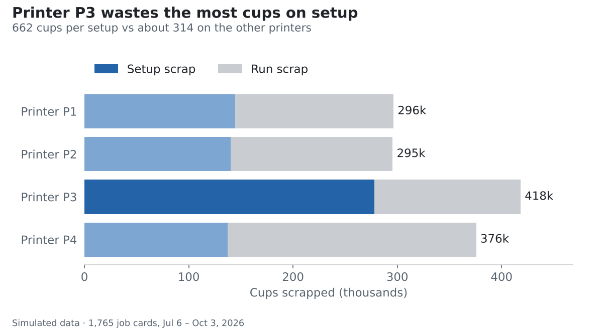
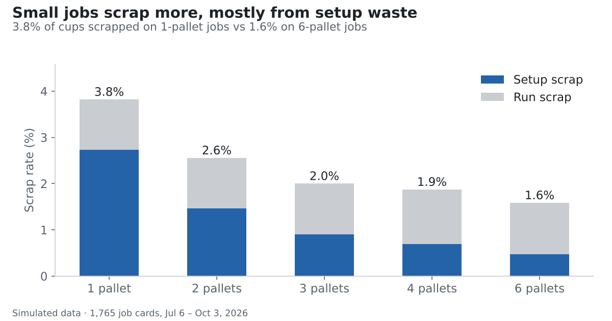
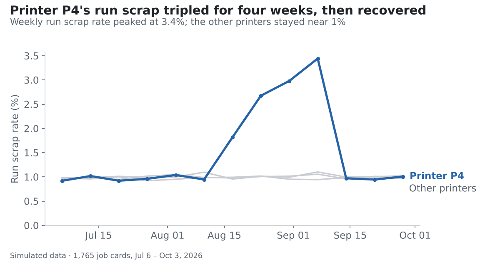

# Printing Scrap Analysis

Learning data analytics by analyzing production scrap at a plant that makes and prints plastic containers for dairy products.

> **All data in this repository is simulated.** It was generated to practice on and contains no real company information.

## Demo

**[Open the interactive dashboard](https://bernardowusumensah.github.io/printing-scrap-analysis/)**: filter by printer and hover the charts for details.

The demo charts and dashboard show where the project is heading. The step-by-step work is in the notebooks in `03_analysis/`. To rebuild the demo: `python 03_analysis/demo_analysis.py` (needs pandas and matplotlib).

## The business problem

The plant has two departments. Molding makes blank cups, which go to the warehouse. Printing takes the blanks from the warehouse, prints customer artwork on them, and returns the finished cups to the warehouse.

Every printing job has a **job card**. The top half is the plan (product, quantity, machine, speed). The bottom half is filled in by hand: machine counter readings, setup scrap and run scrap per shift.

The question this project works toward: **where does scrap come from, what does it cost, and what should be fixed first?**

## Project stages

- [x] Understand the business process and the job card fields
- [ ] Profile the raw data and log every data problem
- [ ] Clean the data
- [ ] Join scrap to production to calculate scrap rates
- [ ] Analyze patterns by machine, shift, job size and product
- [ ] Present findings in a dashboard and short report

## Folder structure

| Folder | Contents |
| --- | --- |
| `01_raw/` | Raw simulated data, never edited |
| `02_clean/` | Cleaned data produced by the notebooks |
| `03_analysis/` | Jupyter notebooks, numbered in the order they run |
| `04_output/` | Charts and reports |
| `docs/` | The dashboard page published with GitHub Pages |

## Key measures

- **Scrap rate** = scrap ÷ (good output + scrap)
- **Counter check**: counter end − counter start should equal cups printed + run scrap

## Tools

Python (pandas), Jupyter Notebook, Excel, Git

## Data privacy

Real company data is kept out of this repository. A `real_data/` folder is listed in `.gitignore` so it can never be uploaded by accident.
